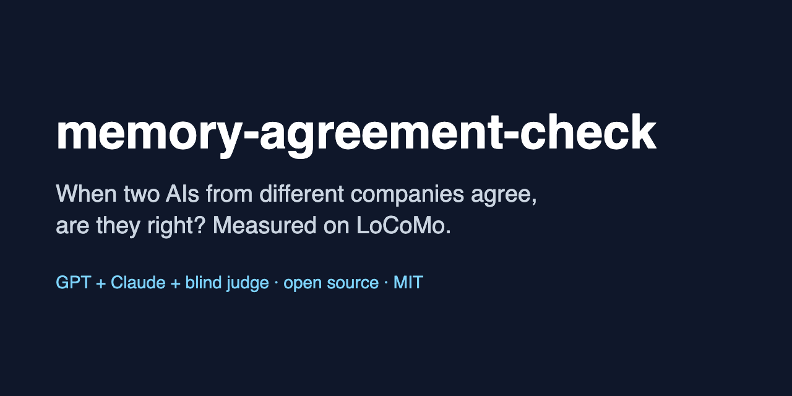

# memory-agreement-check

> Finds the cases where two different AIs agree and are both wrong, because both read the same memory. One command, runs on LoCoMo.



**When two AI models from different companies agree, that is often taken as a sign the answer is right. In an agent with memory, both models usually read the same retrieved memory, so if retrieval missed the fact they can agree on the same wrong answer.**

This tool measures how often that happens, on the [LoCoMo](https://github.com/snap-research/locomo) long-conversation benchmark. For each question it:

1. retrieves memory: a built-in BM25 "simple memory" over the dialogue, or contexts from **your own retriever** (JSONL);
2. asks **two models from different companies separately** (same prompt, neither sees the other's answer);
3. grades both answers two ways: a **blind LLM judge from a third company** (when available) and a LoCoMo-style token-F1 rule (F1 >= 0.5; the official LoCoMo metric is mean F1, which is reported too);
4. reports each model's accuracy, how often they agree, how often they **agree and are both wrong**, by LoCoMo category, and separately for questions where **retrieval missed the evidence** that LoCoMo marks for the question.

Results of the first run are under [`results/`](results/). Headline numbers are [below](#first-numbers).

## Install

Python 3.10+, no required dependencies. Optional: `pip install nltk` (the official LoCoMo scorer stems words with NLTK's Porter stemmer; without it F1 is computed without stemming and the run records `stemmer: none`).

```bash
git clone https://github.com/vadimchernets/memory-agreement-check
cd memory-agreement-check
python -m memcheck download          # fetches LoCoMo at a pinned commit and checks its SHA-256
python -m unittest discover -s tests -t .
```

## Run it: three backends

**1. Your subscriptions (no API keys).** Uses the `codex` CLI (ChatGPT plan) and the `claude` CLI (Claude plan), with the `kimi` CLI as the third-company judge. Codex runs with a read-only sandbox; Claude runs with all tools disabled. Each answering prompt tells the model to use only the excerpts.

```bash
python -m memcheck run --backend cli --n 200 --seed 2026 \
  --model-a cli:codex:gpt-6.1-sol --model-b cli:claude:sonnet --judge cli:kimi
```

**2. APIs (no subscriptions).** Keys from `OPENAI_API_KEY` and `ANTHROPIC_API_KEY`; name the models yourself:

```bash
python -m memcheck run --backend api \
  --model-a api:openai:<openai-model> --model-b api:anthropic:<claude-model> \
  --judge rule          # or a third model, e.g. --judge api:openai:<another-model>
```

**3. Dry (offline).** Deterministic stub models, to try the pipeline in seconds. The default stubs answer correctly only when memory holds the evidence and otherwise give the same plausible wrong answer, which is the failure this tool looks for:

```bash
python -m memcheck run --backend dry --n 200
```

Useful flags: `--k` (turns retrieved by BM25, default 10), `--categories 1,2,3,4`, `--random` (simple random sample instead of equal per category), `--workers` and `--pace` (be gentle with subscription limits), `--name`, `--out`. A run writes `records.jsonl` as it goes, so re-running the same command resumes. `python -m memcheck report results/<run>` recomputes the summary.

## Plug in your own retriever

Write one JSON object per question. `qid` is `<sample_id>/<index of the question in that sample's qa list>`; `python -m memcheck export-questions --out questions.jsonl` lists all 1,986 with their text and category.

```json
{"qid": "conv-26/0", "memories": [{"text": "[D1:3 | 1:56 pm on 8 May, 2023] Caroline: I went to a LGBTQ support group yesterday...", "dia_id": "D1:3", "score": 0.82}]}
{"qid": "conv-26/1", "context": "free-text context, if your system returns one string"}
```

`dia_id` is optional, but with it the tool knows exactly whether the evidence turn was retrieved. Without it, it matches the evidence turn's text against your context (exact substring, or at least 80% of its content words), which works for raw turns and less well for rewritten memories.

```bash
python -m memcheck run --backend cli --contexts my_contexts.jsonl --memory-name my-retriever
```

**Example: FlyHash.** [`examples/flyhash_contexts.py`](examples/flyhash_contexts.py) builds contexts with the FlyHash and SimHash classes from [flyhash-agent-memory](https://github.com/mohanji/flyhash-agent-memory) (Bheemadolu & Odhiambo, [arXiv:2611.05791](https://arxiv.org/abs/2611.05791)), or with exact dense cosine as a reference, over MiniLM embeddings of the dialogue turns:

```bash
git clone https://github.com/mohanji/flyhash-agent-memory
pip install numpy sentence-transformers
python examples/flyhash_contexts.py --flyhash-src flyhash-agent-memory/src --method flyhash --active-bits 32 --out flyhash-k32.jsonl
python -m memcheck run --backend cli --contexts flyhash-k32.jsonl --memory-name flyhash-k32
```

Running the same questions with several code sizes, or against `--method dense`, shows whether shorter codes lead to more cases where both models agree on a wrong answer.

## What is measured

| Measure | Meaning |
|---|---|
| model A / B correct | judged correct. Reported in two views: third-company LLM judge, and LoCoMo token F1 >= 0.5. Accuracy at a threshold is not comparable to published LoCoMo mean-F1 numbers |
| agree | the two answers say the same thing (the judge's call; in the rule view, token F1 between the two answers >= 0.5). Pairs the judge calls "same" but grades differently are counted as agreeing and flagged |
| wrong when they agree | among agreeing pairs, share where both are graded wrong. 1 minus this is the precision of "answer only when both agree" |
| wrong when they agree on a real answer | the same, leaving out pairs where both said "Not mentioned". The prompt tells models to say "Not mentioned" when the excerpts lack the answer, so agreeing on that is the models following instructions on a bad memory; a shared confident wrong answer is the sharper failure |
| both wrong, observed vs if independent | if the two models' errors were independent, both would be wrong on (1 - acc A)(1 - acc B) of questions |
| error correlation φ | correlation between "A wrong" and "B wrong". As a heuristic (the design-effect formula), two checks with correlation φ are worth about 2/(1+φ) independent ones |
| retrieval full / incomplete | whether every evidence turn LoCoMo lists for the question was in the retrieved memory. Questions whose evidence ids cannot be parsed are left out of this split and listed in `summary.md` |

Categories follow the official scorer ([`task_eval/evaluation.py`](https://github.com/snap-research/locomo/blob/main/task_eval/evaluation.py)): 1 multi-hop, 2 temporal, 3 open-domain, 4 single-hop, 5 adversarial (the right answer is to say it was not mentioned). Multi-hop answers are scored as in the official code: the answer is split on commas and each gold item takes its best-matching predicted item, so extra predicted items are not penalised. Proportions carry Wilson 95% intervals; φ and differences carry stratified bootstrap 95% intervals.

## First numbers

200 LoCoMo questions (40 per category, seed 2026); BM25 memory, top 10 turns; `gpt-6.1-sol` (OpenAI, Codex CLI) and `claude-sonnet-5-5` (Anthropic, Claude CLI) answering separately; Kimi (Moonshot) as the blind judge. Categories 1-4 (160 questions; 4 with unparseable evidence ids are left out of the split below). 95% intervals in brackets. Details: [`results/README.md`](results/README.md).

| Memory held all evidence turns? | Questions | Both gave the same real answer | ...and it was wrong | Agreed, counting both "Not mentioned" | ...and wrong |
|---|---|---|---|---|---|
| yes | 71 | 63 | **2 (3.2% [0.9, 10.9])** | 64 | 3 (4.7%) |
| no | 85 | 33 | **15 (45.5% [29.8, 62.0])** | 68 | 50 (73.5%) |

- When both models gave the same real answer, it was wrong 3% of the time with full memory and 45% of the time with incomplete memory: +42 points [+24, +59] pooled, +44 points [+21, +65] when compared within each category and averaged.
- The same pattern holds when answers are graded by the LoCoMo F1 rule instead of the judge (12% vs 66%), and within each category that has enough cases.
- Of the 54 pairs that agreed and were wrong, 37 were both models saying "Not mentioned", as the prompt asks when memory lacks the answer. The other 17 were the same wrong answer, and 15 of those came with memory that missed evidence.
- The two models' errors were strongly correlated: φ = 0.81 [0.72, 0.88]. Both were wrong on 40% of questions, against 20% expected if their errors were independent.

This is one retriever, one model pair, one judge and one seed. It shows an association, not a cause (see [limits](#limits-of-this-first-run)).

## Limits of this first run

- 200 questions, 40 per category, one seed. Per-category intervals are wide.
- One retriever (BM25 over raw turns, top 10), one pair of models, one judge. Other retrievers and models can move every number.
- Association, not cause. Questions whose evidence BM25 misses differ from the others (for example, multi-hop and open-domain questions are retrieved fully far less often), so `summary.md` also gives the comparison within each category. A causal test would answer the same questions with and without the evidence turns in an otherwise good context.
- The grade depends on the grader. The judge and the F1 rule agree on 182/200 (model A) and 171/200 (model B) answers. Accuracy is higher under the judge, mostly because the rule misses paraphrases. Both views are in `summary.md`. The judge's raw replies were not saved in this first run; the tool now saves them and reads only true/false values.
- LoCoMo's evidence labels are imperfect; malformed ids are dropped. "Incomplete retrieval" means LoCoMo's marked evidence was missing, not that the answer was impossible.
- The sample is balanced across categories, so pooled numbers are not LoCoMo-wide averages.
- This is an exploratory measurement, not a preregistered test.

## Try it yourself: Poly Duo

The same idea for everyday use: [Poly Duo](https://github.com/vadimchernets/poly-duo) ([polyhelper.ai/duo](https://polyhelper.ai/duo)) lets your own ChatGPT and Claude check each other on your phone, free and open source. It is a quick way to see two models agree, disagree, and sometimes agree on the same mistake.

## Related work by the author

- V. Chernets, *Agreement Is Not Independent Evidence: Auditable Multi-Model Synthesis Without an API*, preprint, SSRN 7390698, 2026. [polyhelper.ai/research/agreement-not-evidence](https://polyhelper.ai/research/agreement-not-evidence/), [doi:10.5281/zenodo.22821595](https://doi.org/10.5281/zenodo.22821595).
- V. Chernets, *Agreement Inversion Is Not a Mid-Tier Property: Precision of Agreed LLM Answers Follows Pair Accuracy*, preprint, SSRN 7682960, 2026. [polyhelper.ai/research/agreement-inversion](https://polyhelper.ai/research/agreement-inversion/), [doi:10.5281/zenodo.24090580](https://doi.org/10.5281/zenodo.24090580).

If you use this tool, please cite the repository (see [`CITATION.cff`](CITATION.cff)) and LoCoMo:

> Maharana, A., Lee, D.-H., Tulyakov, S., Bansal, M., Barbieri, F., & Fang, Y. (2024). Evaluating Very Long-Term Conversational Memory of LLM Agents. ACL 2024.

## Licenses

- **Code:** MIT ([`LICENSE`](LICENSE)).
- **LoCoMo data:** © the LoCoMo authors, [CC BY-NC 4.0](https://creativecommons.org/licenses/by-nc/4.0/) (see the [LoCoMo repository](https://github.com/snap-research/locomo/blob/main/LICENSE.txt)). The dataset is **not** included here; `python -m memcheck download` fetches it from the official repository. Non-commercial terms apply to the data.
- **Files under `results/`** contain model answers to LoCoMo questions (question ids, not the questions or gold answers). As material derived from LoCoMo they are shared under CC BY-NC 4.0.
